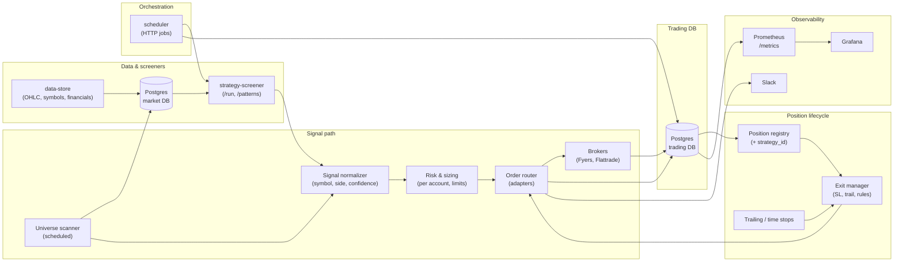

# Trading strategies, pipeline architecture, and implementation plan

This document captures **sample execution strategies** (distinct from strategy-screener *technical* strategies), the **end-to-end system diagram**, **database extensions**, and **phased work** so we can implement DB migrations and code in this repo and related services in order.

---

## 0. What list of stocks do we run on?

| Flow | Universe |
|------|----------|
| **New entries (signals)** | Configured per **execution strategy** via `universe_source` (see table below). Resolution is implemented in `trading_service/universe_resolver.py` using `STRATEGY_SCREENER_URL` and optional `MARKET_DATABASE_URL`. |
| **Monitoring exits / PnL** | **Not** the screener list. Whatever **open positions** the broker returns after `sync-positions` — attribute to an execution strategy when `trading_positions.execution_strategy_id` is set (e.g. after automated entry). |

**`universe_source` values** (after `migrations/trading_universe_sources_extend.sql`):

| Value | Meaning |
|-------|---------|
| `screener_filtered` | Symbols from strategy-screener `GET /run/{screener_strategy_id}` (paginated matches). Optional `config_json`: `universe_cap_filter`, `universe_sector_filter`. |
| `pattern_52w` | Legacy path: `/patterns/52w` with band params in `config_json` (`pct_from_high_min` / `max`, `near_pct`, `at_52w_high`). |
| `screen_52w` | Same API as 52w screen UI: `/patterns/52w` with filters in `config_json.universe_screen` (e.g. `pct_from_high_min`, `sector_filter`, `cap_filter`). |
| `screen_structural` | Structural chart patterns: `/patterns/structural` + `universe_screen` (e.g. `signal`, `pattern`, sector/cap). |
| `screen_candle` | Candle patterns: `/patterns` + `universe_screen`. |
| `union_screener_screen` | Deduped union of screener run + one screen. Needs `screener_strategy_id` and `config_json.union_screen` = `52w` \| `structural` \| `candle`, plus `universe_screen` params for that screen. |
| `full_universe` | All `*-EQ` symbols from market DB via `MARKET_DATABASE_URL` (heavy). |

**Lock rule:** While `trading_positions` has rows for an execution strategy with **non-zero quantity**, you cannot change `universe_source`, `screener_strategy_id`, `screener_strategy_name`, or universe-affecting keys in `config_json` (see `_UNIVERSE_CONFIG_KEYS` in `trading_service/db.py`). `PATCH` returns **409**. `is_active` may still change.

**HTTP (trading-service):** `GET /trading/execution-strategies` (includes `open_positions_count`), `PATCH /trading/execution-strategies/{id}`, `GET /trading/execution-strategies/{id}/universe-preview`, `GET /trading/universe/resolve-all` (batch for scheduler; query `include_symbols`, `symbol_limit`).

**Same symbol in multiple execution strategies:** The broker typically returns **one net line per symbol** (one quantity, one average price). Our DB row is `UNIQUE(account_id, symbol, exchange, side)` with a **single** `execution_strategy_id`. You cannot faithfully assign one broker position to two strategies without **(a)** separate trading accounts, **(b)** internal **lot** ledger (multiple rows you reconcile to the broker), or **(c)** broker sub-accounts/tags if supported. **Tracking today:** average price and quantity come from the broker; `last_synced_at` is when we last pulled positions. **Entry time per strategy** is not stored on the position row yet — use `trading_orders.placed_at` + `strategy_id` when orders are logged, or add `position_opened_at` / lots in a later migration.

**UI:** strategy-screener **Trading** page: **Positions** tab groups rows by execution strategy (or “Unassigned”); **Strategies** tab lists the catalog, universe source + screener id edits (when unlocked), preview modal, and per-account enable toggles (`REACT_APP_TRADING_API_URL` must point at trading-service).

So: **filtered from screener is the default** for entries; the **entire list** is optional and explicit. Link each seeded strategy to a screener strategy id when you create those strategies in strategy-screener.

---

## 1. Two meanings of “strategy”

| Layer | Where it lives | Role |
|-------|----------------|------|
| **Technical screener** | strategy-screener (`strategies`, `strategy_conditions`, `/run/{id}`) | Filters universe with indicators (EMA, RSI, MACD, 52w, sectors, etc.). |
| **Execution / risk strategy** | trading-service (this doc + future tables) | How to size, enter (pullback vs breakout), exit (SL, trail, time), and which accounts run it. |

A single **execution strategy** usually **references** one screener strategy (by id or slug) and adds **risk and exit rules**.

---

## 2. Target architecture (diagram)

High-level flow: market data → universe & screeners → signals → risk → orders → brokers; parallel path for position monitoring and exits.



**ASCII (same idea):**

```
data-store ──► market DB ◄── strategy-screener (screeners)
                    │                    │
                    ▼                    ▼
              Universe scan ──► Signals ──► Risk/sizing ──► Order router ──► Brokers
                    │                                        │
                    │                                        ▼
                    │                                  trading DB
                    │                                        │
                    └──────────── Position sync ◄───────────┘
                                         │
                              Exit manager / trailing stops
                                         │
                                         └──► Orders (exit) ──► Slack / metrics
scheduler ──► screener admin, trading admin, data-store runner
```

---

## 3. Sample execution strategies

These are **templates** you can register in DB and map to screener strategies and accounts. Names are illustrative.

| Slug | Profile | Entry style | Typical screener link | Exit / risk |
|------|---------|-------------|------------------------|-------------|
| `momentum_breakout_aggressive` | Aggressive | **Breakout** — enter on strength / new highs after screener pass | e.g. multi-TF alignment + volume | **Trailing stop** 2–3% from peak; widen in high ATR; max position 15% of equity |
| `momentum_pullback_conservative` | Conservative | **Pullback** — screener flags trend; enter on dip to MA / support zone | e.g. trend + RSI dip | **Fixed SL** 4–5% below entry; optional partial at +8%; no trail until +5% |
| `swing_confluence_core` | Balanced | **Confluence** — multiple indicators agree (trend + MACD + RSI band) | dedicated “confluence” screener | **Breakeven** after +3%; trail 2% thereafter; max hold 20 sessions |
| `near_52w_quality` | Conservative | **Breakout / continuation** near 52w with quality filter | 52w band (5–10%) + optional financials gate | SL under recent swing low; time stop if flat 10 days |
| `sector_rotation_momo` | Aggressive | **Sector-relative** — strong names in top parent sectors | screener + sector filter from Chart Patterns / Run | Tighter trail in extended sectors; cut if sector breadth flips |
| `mean_reversion_small` | Speculative | **Pullback** extreme — oversold bouncer (tight universe) | RSI/MFI oversold + not in structural downtrend | **Tight SL** 2–3%; hard **time exit** 3–5 days |
| `commodity_trend` | Balanced | **Breakout / trend** on MCX | commodity strategies in screener | Broker-compatible SL; session flatten rules |

**Screener alignment (examples):**

- **Breakout:** conditions on `close` vs resistance / Donchian / recent high + volume.
- **Pullback:** trend filter (e.g. close > EMA200) + short-term RSI or touch of EMA20.
- **Confluence:** AND of trend, MACD cross, RSI in band — mirror how you already build `strategy_conditions`.

---

## 4. Database: current vs proposed

### 4.1 Already in `migrations/trading_schema.sql`

- `trading_accounts`, `trading_orders`, `trading_positions`, `trading_pnl_snapshots`, `trading_trailing_stops`
- `trading_orders.strategy_id` / `strategy_name` exist but are not fully wired to a **strategy registry**

### 4.2 Proposed additions (next migration)

**Table: `trading_execution_strategies`**

| Column | Type | Notes |
|--------|------|--------|
| `id` | SERIAL PK | |
| `slug` | VARCHAR(64) UNIQUE | e.g. `momentum_breakout_aggressive` |
| `display_name` | VARCHAR(256) | |
| `profile` | VARCHAR(32) | `aggressive` \| `balanced` \| `conservative` \| `speculative` |
| `entry_style` | VARCHAR(32) | `breakout` \| `pullback` \| `confluence` \| `sector_rotation` \| `mean_reversion` |
| `universe_source` | VARCHAR(32) | `screener_filtered`, `full_universe`, `pattern_52w`, `screen_*`, `union_screener_screen` — see §0 |
| `screener_strategy_id` | INTEGER NULL | FK to strategy-screener DB if shared server; else store id only as reference |
| `screener_strategy_name` | VARCHAR(128) NULL | Denormalized for ops |
| `config_json` | JSONB | SL%, trail%, max position %, max concurrent positions, time stops, etc. |
| `is_active` | BOOLEAN DEFAULT true | |
| `created_at` / `updated_at` | TIMESTAMP | |

**Table: `trading_strategy_account_map`**

| Column | Type | Notes |
|--------|------|--------|
| `id` | SERIAL PK | |
| `execution_strategy_id` | INTEGER FK → `trading_execution_strategies` | |
| `account_id` | INTEGER FK → `trading_accounts` | |
| `is_enabled` | BOOLEAN DEFAULT true | Plug-and-play per family account |
| `overrides_json` | JSONB NULL | Per-account caps overrides |
| UNIQUE(`execution_strategy_id`, `account_id`) | | |

**Alter `trading_positions`**

- Add `execution_strategy_id` INTEGER NULL REFERENCES `trading_execution_strategies(id)` (or `strategy_slug` VARCHAR for looser coupling first).

**Alter `trading_orders`**

- Ensure `strategy_id` documents **execution** strategy id when placed by automation; keep `strategy_name` for human-readable audit.

**Optional later**

- `trading_signals` — queue of normalized signals before order placement (status: `new` → `accepted` → `rejected` → `ordered`)
- `trading_outbox` — for async dispatch (RabbitMQ / Pub/Sub) if you outgrow HTTP-only scheduler

---

## 5. Metrics and Grafana (by account + strategy)

**Prometheus labels to add** (on top of existing `account_id`, `display_name`, `broker`):

- `execution_strategy_id`, `execution_strategy_slug`, `profile` (optional)

**Example metrics**

- `trading_pnl_total{account_id, execution_strategy_slug, ...}`
- `trading_position_unrealized_pnl{..., execution_strategy_slug, symbol, side}`
- Counters: `trading_signals_total`, `trading_orders_filled_total{execution_strategy_slug, side}`

**Grafana**

- Dashboard variables: `account`, `execution_strategy`
- Panels: PnL and open risk **per strategy** and **per account**

---

## 6. Implementation phases (aligned with the diagram)

| Phase | Scope | Outcome |
|-------|--------|---------|
| **P1** | Migration: `trading_execution_strategies`, `trading_strategy_account_map`, `trading_positions.execution_strategy_id` | DB ready; seed rows for 2–3 sample strategies |
| **P2** | Admin/API: CRUD or read-only list + enable/disable account mapping | Ops can turn strategies on per account without code deploy |
| **P3** | `metrics.py` + Grafana JSON: strategy labels | Visibility by strategy |
| **P4** | Exit manager worker: read positions + `trading_trailing_stops` + LTP; place exits | Automated trailing / SL where not broker-native |
| **P5** | Signal pipeline: POST `/trading/signals` or internal job calling screener + sizing | End-to-end entry automation |
| **P6** | Optional: Redis (dedup, LTP cache), RabbitMQ/Pub/Sub (signal queue) | Scale and decouple |

---

## 7. Repo responsibilities (quick reference)

| Repo | Responsibility |
|------|----------------|
| **data-store** | Ingest OHLC, symbols, financials → market DB |
| **strategy-screener** | Technical filters, Run page, patterns (52w, sectors, structural) |
| **trading-service** | Accounts, orders, positions, PnL, broker adapters, metrics, future execution strategies & exit manager |
| **trading-service/scheduler** | Central cron → HTTP to screener, trading, data-store runner |
| **deploy/docker-compose.ec2.yml** | Single-VM bring-up of stack |

---

## 8. Next steps (concrete)

1. ~~Execution strategies migration + seeds~~ — done (`trading_execution_strategies.sql`).
2. ~~Extended `universe_source` + resolver + lock on open positions~~ — done (`trading_universe_sources_extend.sql`, `universe_resolver.py`, `patch_execution_strategy`).
3. ~~Scheduler hook~~ — `GET /trading/universe/resolve-all` + job `universe_resolve_all` in `scheduler/schedules.yaml`.
4. **Remaining:** signal pipeline (normalize → risk → orders), optional `trading_signals` table, exit manager worker (§6 P4–P5).

---

## 9. Document history

- **Created:** living architecture + sample strategies + DB plan for automated multi-account trading on top of existing screener and data pipeline.

When you implement a phase, append a short changelog section here or in `CHANGELOG.md`.
